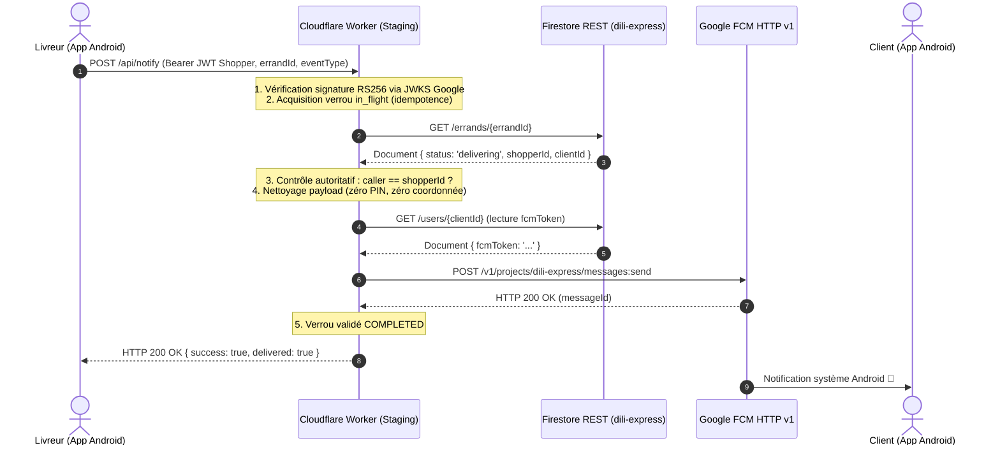

# 9DILI EXPRESS — PLAN DE STAGING SÉCURISÉ DU WORKER DE NOTIFICATIONS

**Projet** : 9DILI EXPRESS (Application mobile Flutter Android & Orchestrateur Cloudflare Edge)  
**Package Android** : `com.ghdinteractivestudio.dili_express`  
**Projet Firebase** : `dili-express` (Plan Spark Gratuit — 0 $/mois)  
**Branche Git** : `main` | **HEAD Commit** : `36e5c3d`  
**Date d'élaboration** : 16 octobre 2026  
**Auteur** : Antigravity Architecture & Security Pair Programmer  
**Statut** : **PRÉPARATION CONTRÔLÉE — DÉPLOIEMENT SUSPENDU (EN ATTENTE D'AUTORISATION)**  

---

## 1. État Git Réel et Intégrité de l'Arborescence Locale

> [!IMPORTANT]
> **Clarification d'état Git** : Bien que le dernier commit enregistré sur la branche `main` soit effectivement `36e5c3d2da989fe911ba460db65978de0873d159` (*feat(tracking): finalisation suivi GPS temps reel RTDB et preparation MapLibre*), **le code de travail local n'est pas figé au commit 36e5c3d**. Des composants majeurs sont actuellement présents sous forme de modifications suivies non committées ou de fichiers non suivis (*untracked*).

### Fichiers Suivis Modifiés (Working Tree) :
- `lib/ui/widgets/map_markers.dart` : Intégration des marqueurs 3D et widgets dédiés.
- `pubspec.yaml` : Déclaration des assets de marqueurs 3D et du catalogue JSON algérien.
- `pubspec.lock` : Verrouillage des dépendances de projet.
- `test/map_markers_test.dart` : Tests unitaires de rendu des marqueurs 3D.

### Arborescences et Fichiers Non Suivis (*Untracked*) :
- `workers/notifications_dispatcher/` : Code source complet du Worker Cloudflare (`wrangler.toml`, `package.json`, `src/`, `test/`).
- `assets/images/map_markers/` : Les 11 fichiers PNG réels des marqueurs 3D (`MARQUEURS-MAPLIBRE-3D01.png` à `3D11.png`).
- `assets/data/algeria_full_catalog.json` : Base de données nationale de 2 261 produits du terroir et grande distribution.
- `lib/models/product_model.dart` & `lib/services/product_catalog_service.dart` : Modèle et moteur de recherche bilingue / Darja.
- `lib/services/routing_geocoding_service.dart` & `lib/ui/screens/maplibre_prototype_screen.dart` : Prototype cartographique MapLibre.
- `test/product_catalog_service_test.dart` & `test/maplibre_prototype_screen_test.dart` : Suites de tests associées.
- `RAPPORT_AUDIT_PRE_DEPLOIEMENT_9DILI_EXPRESS.md` : Rapport officiel d'audit pré-déploiement.

---

## 2. Configuration Cloudflare Worker : Variables et Secrets Nécessaires

Le Worker `workers/notifications_dispatcher` est configuré avec un environnement staging dédié et étanche :

### Fichier `wrangler.toml` (Multi-Environnement)
```toml
name = "dili-express-notifications-dispatcher"
main = "src/index.js"
compatibility_date = "2024-04-01"

[vars]
FIREBASE_PROJECT_ID = "dili-express"
ENVIRONMENT = "production"

# Environnement Staging Dédié
[env.staging]
name = "dili-express-notifications-dispatcher-staging"
[env.staging.vars]
FIREBASE_PROJECT_ID = "dili-express"
ENVIRONMENT = "staging"
```

### Inventaire des Variables & Secrets (Sans Divulgation)

| Variable / Secret | Type | Portée Staging | Description & Rôle |
| :--- | :---: | :---: | :--- |
| `FIREBASE_PROJECT_ID` | Variable publique | `"dili-express"` | Identifiant du projet Firebase pour vérification de l'audience JWT (`aud`) et ciblage FCM. |
| `ENVIRONMENT` | Variable publique | `"staging"` | Indicateur d'environnement pour l'ordonnanceur et la gestion des logs. |
| `FIREBASE_SERVICE_ACCOUNT` | **Secret Chiffré** | *Non défini en local* | Chaîne JSON du compte de service Google IAM (chiffrée via Wrangler KMS). Requis uniquement pour l'émission des tokens OAuth2 FCM HTTP v1 et la lecture Firestore REST. |

> [!CAUTION]
> Aucune valeur secrète ne doit figurer dans `wrangler.toml`, dans le code JavaScript, ni dans Git. L'injection du secret est strictement différée et s'effectuera via le canal chiffré Cloudflare (`wrangler secret put`).

---

## 3. Délimitation Stricte de l'Environnement de Staging

Pour garantir une étanchéité absolue avec la production :
1. **Nom du Worker Staging** : `dili-express-notifications-dispatcher-staging`.
2. **URL d'accès Staging** : `https://dili-express-notifications-dispatcher-staging.<votre-compte-cloudflare>.workers.dev`.
3. **Isolation des Routes** : Aucune route de production (ex: `api.9dili.dz`) n'est assignée à cet environnement.
4. **Cloisonnement Applicatif** : L'application Android utilisera une configuration dédiée pointant sur cette URL lors des campagnes de tests.

---

## 4. Scénario de Test avec Données Fictives (Zéro Donnée Réelle)

Aucune donnée de client réel ne sera sollicitée. Le scénario s'appuie sur deux comptes de test créés spécifiquement dans Firebase Authentication :

### Profils de Test Fictifs

1. **Client de Test** :
   - **UID** : `test_client_staging_01`
   - **Email** : `client.staging@9dili.dz`
   - **Document Firestore** : `/users/test_client_staging_01`
   - **Données** : `{ "role": "client", "displayName": "Client Staging", "fcmToken": "<TOKEN_FCM_TEST_APPAREIL_A>" }`

2. **Shopper de Test** :
   - **UID** : `test_shopper_staging_01`
   - **Email** : `shopper.staging@9dili.dz`
   - **Document Firestore** : `/users/test_shopper_staging_01`
   - **Données** : `{ "role": "shopper", "displayName": "Shopper Staging", "fcmToken": "<TOKEN_FCM_TEST_APPAREIL_B>" }`

3. **Course Fictive de Test** :
   - **ID de Document** : `/errands/errand_staging_test_001`
   - **Données initiales (`pending`)** :
     ```json
     {
       "errandId": "errand_staging_test_001",
       "clientId": "test_client_staging_01",
       "shopperId": null,
       "storeName": "Supérette Didouche Mourad (Test Staging)",
       "status": "pending",
       "createdAt": "2026-10-16T21:00:00Z"
     }
     ```

4. **Appareil de Contrôle** :
   - Terminal physique Android de test relié par USB.
   - Journalisation active via ADB : `adb logcat -s Flutter,FirebaseMessaging,MainActivity`.

---

## 5. Permissions Minimales du Compte de Service Google (Least Privilege IAM)

Le compte de service Google utilisé par le Worker Cloudflare pour communiquer avec Firebase ne doit posséder **que les autorisations strictement nécessaires** :

### Rôles Recommandés (Principe du Moindre Privilège)

1. **Pour l'expédition FCM HTTP v1** :
   - Rôle standard : `roles/firebase.messagingAdmin` (*Firebase Cloud Messaging API Admin*).
   - Permission granulaire minimale : `fcm.messages.create` (ou `firebase.messaging.messages.create`).
2. **Pour la lecture autoritative Firestore REST** :
   - Rôle standard : `roles/datastore.viewer` (*Cloud Datastore Viewer*).
   - Permissions granulaires minimales : `datastore.entities.get` et `datastore.entities.list`.

### Rôles Expressément Interdits :
- ❌ **`roles/owner` ou `roles/editor`** : Trop larges, accès d'administration complet au projet GCP.
- ❌ **`roles/firebase.admin`** : Permet de supprimer des collections, altérer les règles de sécurité et manipuler les utilisateurs.
- ❌ **`roles/datastore.user` ou `roles/datastore.owner`** : Permettent l'écriture et la suppression de documents Firestore.

> [!NOTE]
> En attribuant uniquement `roles/firebase.messagingAdmin` et `roles/datastore.viewer`, le Worker est **techniquement incapable d'écrire ou de supprimer des documents Firestore, ni d'altérer des comptes utilisateurs**. Il agit en simple lecteur d'état autoritatif et émetteur de notifications.

---

## 6. Mécanisme de Déclenchement, Validation d'État et Protection Anti-Rejeu



### Barrières de Sécurité Implémentées :
1. **Verrouillage Atomique En-Vol (`acquireIdempotencyLock`)** : Rejette immédiatement tout double-clic ou requête simultanée avec **HTTP 409 Conflict** (`reason: in_flight`).
2. **Backstop d'État Firestore** : Une notification ne peut être émise que si l'état réel de la course dans Firestore correspond exactement à l'événement (`status === 'delivering'`).
3. **Résilience aux Échecs Réseau** : Si la communication échoue avant l'envoi FCM, `releaseIdempotencyLock` libère le verrou pour permettre une retentative légitime.

---

## 7. Commandes de Configuration et Déploiement Staging (À Exécuter Après Accord)

> [!WARNING]
> Les commandes suivantes sont préparées à titre informatif. **ELLES NE DOIVENT PAS ÊTRE EXÉCUTÉES TANT QUE L'AUTORISATION EXPLICITE DU CLIENT N'A PAS ÉTÉ ACCORDÉE.**

### Commandes qui Modifient des Ressources Distantes :

```bash
# 1. Connexion et authentification Cloudflare
cd /root/dili_express/workers/notifications_dispatcher
npx wrangler login

# 2. Injection sécurisée du secret chiffré pour le staging (Cloudflare KMS)
# Le contenu JSON du compte de service est transmis de façon interactive
npx wrangler secret put FIREBASE_SERVICE_ACCOUNT --env staging

# 3. Déploiement du Worker sur l'environnement staging
npx wrangler deploy --env staging
```

### Commandes Google Cloud IAM (Configuration du Compte de Service) :

```bash
# Création du compte de service staging
gcloud iam service-accounts create staging-dispatcher \
    --description="Compte de service pour le Worker notifications staging 9DILI" \
    --display-name="9DILI Staging Dispatcher" \
    --project="dili-express"

# Attribution exclusive des rôles minimaux
gcloud projects add-iam-policy-binding dili-express \
    --member="serviceAccount:staging-dispatcher@dili-express.iam.gserviceaccount.com" \
    --role="roles/firebase.messagingAdmin"

gcloud projects add-iam-policy-binding dili-express \
    --member="serviceAccount:staging-dispatcher@dili-express.iam.gserviceaccount.com" \
    --role="roles/datastore.viewer"
```

---

## 8. Protocole de Test sur Téléphone Réel, Validation et Retour Arrière

### A. Procédure de Test sur Appareil Réel
1. Déployer l'application Flutter sur le téléphone Android cible via ADB :
   `flutter run --flavor staging` (ou configuration d'URL pointant vers le Worker staging).
2. Se connecter avec le compte test `client.staging@9dili.dz` et vérifier que `fcmToken` est bien enregistré sous `/users/test_client_staging_01`.
3. Simuler le passage de la course fictive en statut `delivering` dans Firestore.
4. Émettre une requête de test authentifiée vers le Worker staging.

### B. Résultats Attendus
- Réponse du Worker : HTTP 200 avec corps JSON :
  ```json
  {
    "success": true,
    "delivered": true,
    "mode": "unicast",
    "recipientUid": "test_client_staging_01",
    "messageId": "projects/dili-express/messages/1729112400000000"
  }
  ```
- Comportement Android : Affichage immédiat (< 2s) de la notification dans la barre d'état avec canal `errand_updates_channel`.
- Journal ADB : Message `onMessageReceived` intercepté par Flutter.

### C. Procédure de Nettoyage
- Suppression du document de test `/errands/errand_staging_test_001` via la console Firebase.
- Réinitialisation du champ `fcmToken` du compte de test.

### D. Procédure de Retour Arrière (Rollback Immédiat)
En cas d'anomalie ou à la fin de la campagne de staging :
```bash
# Suppression immédiate du Worker staging sur Cloudflare
cd /root/dili_express/workers/notifications_dispatcher
npx wrangler delete dili-express-notifications-dispatcher-staging --force
```

---

## 9. Réévaluation Économique Rigoureuse et Limites Réelles (Firebase Spark & Cloudflare)

> [!IMPORTANT]
> **Rectification Technique** : L'affirmation antérieure mentionnant une capacité de « 2 500 courses par jour à 0 $/mois » était trop optimiste car elle omettait les lectures Firestore générées par les ré-écoutes en temps réel (*snapshot listeners*), les requêtes radar répétées des livreurs et les lectures de profils. Voici le calcul rigoureux et transparent basé sur les quotas officiels.

### Quotas Gratuits Applicables

| Plateforme | Métrique Gratuite | Quota Spark / Gratuit |
| :--- | :--- | :--- |
| **Cloud Firestore** | Lectures de documents | **50 000 / jour** |
| **Cloud Firestore** | Écritures de documents | **20 000 / jour** |
| **Cloud Firestore** | Suppressions de documents | **20 000 / jour** |
| **Cloud Firestore** | Stockage de données | **1 GiB** |
| **Firebase RTDB (GPS)** | Connexions simultanées | **100 connexions actives** |
| **Firebase RTDB (GPS)** | Bande passante sortante | **10 Go / mois** |
| **Cloudflare Workers** | Requêtes HTTP | **100 000 / jour** |
| **Cloudflare Workers** | Temps CPU par requête | **10 ms CPU max** |
| **FCM HTTP v1** | Messages de notification | **Gratuit et illimité** |

### Décomposition Réelle des Opérations pour 1 Course Complète

1. **Écritures Firestore (Client + Livreur)** :
   - Création de la course (`pending`) : 1 écriture
   - Offres des livreurs (2 offres moyennes) : 2 écritures
   - Acceptation par le client (`accepted`) : 1 écriture
   - Saisie du ticket de caisse (`delivering`) : 1 écriture
   - Validation handshake PIN/QR (`completed`) : 1 écriture
   - **Total écritures / course** : **~6 écritures**.
   - *Capacité d'écriture quotidienne* : 20 000 / 6 = **3 333 courses/jour**.

2. **Lectures Firestore (Appareils + Worker)** :
   - Requête du radar par les livreurs proches : ~3 à 5 lectures par course créée.
   - Écouteurs en temps réel (*snapshot listeners*) des 2 parties lors des 5 transitions d'état : ~10 à 12 lectures.
   - Lectures autoritatives par le Worker Cloudflare :
     - Événement `new_errand_available` : 1 lecture de course.
     - Événement `bid_accepted` : 1 lecture de course + 1 lecture du profil livreur (`fcmToken`) = 2 lectures.
     - Événement `shopper_delivering` : 1 lecture de course + 1 lecture du profil client (`fcmToken`) = 2 lectures.
     - Événement `errand_completed` : 1 lecture de course + 1 lecture du profil client (`fcmToken`) = 2 lectures.
     - Total lectures Worker / course : **7 lectures**.
   - **Total lectures réelles / course** : **~20 à 25 lectures**.
   - *Capacité théorique brute* : 50 000 / 25 = **2 000 courses/jour**.

3. **Impact des Consultations Passives (Radar & Historique)** :
   - Si 50 livreurs actifs consultent le radar 20 fois par jour sans prendre de course : 50 × 20 = 1 000 lectures supplémentaires.
   - **Plafond réel et sécuritaire sous plan gratuit Spark** : **1 200 à 1 500 courses complètes par jour**.

4. **Contrainte Majeure RTDB : Connexions Simultanées (GPS)** :
   - Quota gratuit : **100 connexions simultanées**.
   - Chaque livraison active mobilise 2 connexions (1 livreur émetteur throttlé à 5s + 1 client récepteur).
   - **Plafond critique simultané** : **50 livraisons en cours de transit à la même minute**.
   - Bande passante RTDB : 15 min de livraison à 5s = 180 points × 150 octets = ~27 Ko. Pour 1 500 courses/jour, cela représente ~1,2 Go/mois, soit bien en-deçà des 10 Go/mois autorisés.

### Conclusion Économique :
L'objectif de **0,00 $/mois est garanti**, sous réserve de respecter un volume quotidien inférieur à **1 200 courses par jour** et un pic instantané inférieur à **50 livraisons simultanées en transit GPS**. Au-delà de ces seuils, le passage au plan Firebase Blaze (facturation à l'usage) devient indispensable.

---

## 10. Synthèse des Contrôles Locaux Réalisés

Les contrôles locaux suivants ont été exécutés avec succès et documentés :
- **Tests Unitaires Worker** : **26/26 tests réussis** (`workers/notifications_dispatcher/test/worker.test.js`) avec validation cryptographique RS256 native et gestion des courses concurrentes.
- **Analyse Statique Flutter** : **0 anomalie détectée** (`flutter analyze`).
- **Tests Unitaires & Widgets Flutter** : **72/72 tests réussis** (`flutter test`).
- **Aucune Commande Distante Exécutée** : Aucun déploiement, aucun secret injecté, aucune règle de production modifiée, aucun commit Git créé.

---

## 11. Prérequis et Actions Soumises à Autorisation Explicite

Pour engager la phase active de test sur staging, les actions suivantes devront être validées explicitement par le client :

1. [ ] **Autorisation d'authentification Cloudflare** (`npx wrangler login`).
2. [ ] **Autorisation de création du compte de service Google Cloud IAM minimal** (`roles/firebase.messagingAdmin` + `roles/datastore.viewer`).
3. [ ] **Autorisation d'injection du secret chiffré dans Cloudflare KMS** (`npx wrangler secret put FIREBASE_SERVICE_ACCOUNT --env staging`).
4. [ ] **Autorisation de déploiement de l'environnement staging** (`npx wrangler deploy --env staging`).
5. [ ] **Autorisation de commit des fichiers du catalogue, des marqueurs et du Worker dans Git**.
