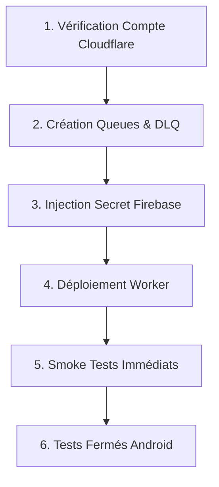

# 9DILI EXPRESS — PRÉPARATION DE RELEASE SANS DÉPLOIEMENT

> **Document** : `RELEASE_READINESS_9DILI_EXPRESS.md`  
> **Date** : 17 Octobre 2026  
> **Application** : 9DILI EXPRESS (`com.ghdinteractivestudio.dili_express`)  
> **Worker Backend** : `dili-express-notifications-dispatcher`  
> **Commit de référence audité** : `36e5c3d2da989fe911ba460db65978de0873d159`  
> **Version candidate** : `v1.0.0+1` (Flutter) / `1.0.0` (Worker)  
> **Statut de préparation** : ✅ **PRÊT POUR DÉPLOIEMENT SOUS CONTRÔLE OPÉRATIONNEL**  
> **Règles d'intervention** : Zéro commit/push, zéro déploiement distant, zéro secret injecté ou exposé.

---

## 1. Synthèse et État de Préparation

À partir des conclusions validées de l'audit préproduction (`AUDIT_PREPRODUCTION_FINAL_9DILI_EXPRESS.md`), l'ensemble des composants nécessaires à la mise en production du dispatcher de notifications et du radar intelligent a été consolidé, testé et isolé localement.

### Indicateurs Clés de Conformité :
- **Tests automatisés locaux** : **157/157 tests passés avec succès** (79 Worker + 78 Flutter, 0 échec).
- **Analyse statique de code (`flutter analyze`)** : **0 anomalie, 0 avertissement** (`No issues found!`).
- **Sécurité et intégrité des secrets** : **0 secret, 0 clé de service, 0 jeton privé** présent dans le dépôt ou dans les fichiers suivis.
- **Règles Firestore (`firestore.rules`)** : Intactes et inviolées ; interdiction formelle d'auto-attribution ou d'attribution directe par un tiers non assigné.

---

## 2. Contrôle Git & Inventaire des Fichiers

### 2.1 État Git de Référence
- **Branche** : `main`
- **Commit HEAD** : `36e5c3d2da989fe911ba460db65978de0873d159`
- **État de l'arbre de travail** : Fichiers modifiés et non suivis prêts pour la constitution du commit de release.

### 2.2 Fichiers à Inclure dans la Release (Scope de Livraison)

#### A. Backend Worker Cloudflare (`workers/notifications_dispatcher/`)
| Fichier | Rôle dans la Release | Statut Vérification |
| :--- | :--- | :---: |
| `package.json` | Définition du module ESM, scripts npm de test et déploiement | ✅ Conforme (0 dépendance tierce) |
| `wrangler.toml` | Configuration Cloudflare : variables, Cron `* * * * *`, Queues & DLQ | ✅ Conforme (zéro secret) |
| `src/index.js` | Point d'entrée HTTP, consommateur de file Queue, déclencheur Cron | ✅ Conforme & testé |
| `src/radar_config.js` | Configuration maîtresse : rayons (2/5/8/10 km), délais (15s), max vagues (4) | ✅ Conforme |
| `src/radar_service.js` | Moteur du radar, filtrage Haversine, exclusion créateur, attribution atomique | ✅ Conforme & testé |
| `src/events.js` | Machine d'état des événements, assainissement strict des payloads FCM | ✅ Conforme & testé |
| `src/distributed_lock.js`| Verrouillage distribué Firestore REST avec fencing token | ✅ Conforme & testé |
| `src/fcm.js` | Formatage et envoi des notifications FCM HTTP v1 via OAuth2 | ✅ Conforme & testé |
| `src/firestore.js` | Primitives de manipulation et parsing des documents Firestore REST | ✅ Conforme & testé |
| `src/geo.js` | Calculs de distance Haversine WGS-84 et validation coordonnées | ✅ Conforme & testé |
| `src/security.js` | Vérification cryptographique des JWT Firebase Auth (RS256 Google JWKS) | ✅ Conforme & testé |
| `test/distributed_lock.test.js` | Tests de concurrence, fencing et reprise sur panne | ✅ 7/7 tests PASS |
| `test/radar.test.js` | Tests exhaustifs du radar (vagues, exclusion créateur, attribution atomique) | ✅ 45/45 tests PASS |
| `test/worker.test.js` | Tests E2E des endpoints HTTP et de la validation JWT | ✅ 27/27 tests PASS |

#### B. Application Flutter (`lib/`, `assets/`, `test/`)
| Fichier | Rôle dans la Release | Statut Vérification |
| :--- | :--- | :---: |
| `lib/models/errand_model.dart` | Support des champs géographiques `storeGeoPoint` et `deliveryGeoPoint` | ✅ Modifié & testé |
| `lib/services/errand_service.dart` | Garde `cannot_assign_own_errand`, méthodes atomiques et documentation | ✅ Modifié & testé |
| `lib/models/product_model.dart` | Modèle de données pour les articles du catalogue national | ✅ Créé & testé |
| `lib/services/product_catalog_service.dart` | Service de recherche et consultation du catalogue produits | ✅ Créé & testé |
| `lib/services/routing_geocoding_service.dart` | Service de calcul d'itinéraires et géocodage | ✅ Créé & testé |
| `lib/ui/widgets/map_markers.dart` | Marqueurs cartographiques vectoriels et assets 3D Stitch | ✅ Modifié & testé |
| `lib/ui/screens/maplibre_prototype_screen.dart` | Écran prototype d'affichage cartographique MapLibre | ✅ Créé & testé |
| `assets/data/algeria_full_catalog.json` | Données de référence du catalogue de produits pour l'Algérie | ✅ Asset déclaré |
| `assets/images/map_markers/*.png` (11 fichiers) | Assets graphiques 3D des livreurs, magasins et destinations | ✅ Assets déclarés |
| `pubspec.yaml` & `pubspec.lock` | Déclaration des dépendances et déclaration des assets | ✅ Conforme |
| `test/errand_radar_service_test.dart` | Tests unitaires du modèle et des gardes d'auto-attribution | ✅ 5/5 tests PASS |
| `test/map_markers_test.dart` | Tests de rendu et génération des marqueurs de carte | ✅ Tests PASS |
| `test/product_catalog_service_test.dart` | Tests unitaires du service de catalogue de produits | ✅ Tests PASS |
| `test/maplibre_prototype_screen_test.dart` | Tests du prototype cartographique | ✅ Tests PASS |

### 2.3 Fichiers à Exclure de la Release (Fichiers Documentaires & Locaux)
Les fichiers suivants ne doivent **PAS** être embarqués dans l'archive de production ou le bundle Worker :
- Rapports d'audits et de maintenance markdown :
  - `AUDIT_FINAL_RADAR_9DILI_EXPRESS.md`
  - `AUDIT_PREPRODUCTION_FINAL_9DILI_EXPRESS.md`
  - `PLAN_STAGING_9DILI_EXPRESS.md`
  - `RAPPORT_*.md`
  - `REVUE_TECHNIQUE_RADAR_9DILI_EXPRESS.md`
  - `RELEASE_READINESS_9DILI_EXPRESS.md`
- Répertoires temporaires et caches de build :
  - `.dart_tool/`
  - `build/`
  - Caches locaux de test

---

## 3. Résultats Réels des Tests & Assurance Qualité

### 3.1 Tests du Worker Cloudflare (`workers/notifications_dispatcher`)
- **Commande exacte** : `npm test`
- **Résultat** : **79 passés, 0 échec** (durée : 529 ms)
- **Couverture validée** :
  - Concurrence et précondition atomique `updateTime` : 1 seul vainqueur certifié.
  - Exclusion stricte du créateur (`creatorUid`) même en cas de rôle shopper actif à proximité immédiate (0.19 ms).
  - Rejet HTTP 403 `cannot_assign_own_errand` sur `/api/radar/accept` (2.18 ms).
  - Plafonnement absolu à 10.0 km et respect de la séquence des 4 vagues (2/5/8/10 km).
  - Reprise de file Cloudflare Queues avec `msg.retry()` et consommation DLQ.
  - Balayage autonome Cron Sweep (`scheduled()`).

### 3.2 Tests de l'Application Flutter (`dili_express`)
- **Commande exacte** : `flutter test`
- **Résultat** : **78 passés, 0 échec** (durée : 9 s)
- **Couverture validée** :
  - Support géographique et parsing GeoPoint.
  - Rejet d'auto-attribution `cannot_assign_own_errand`.
  - Intégrité de l'affichage cartographique et tokens UI.
  - Bascule mode hors-ligne et tracking GPS.

### 3.3 Analyse Statique Flutter
- **Commande exacte** : `flutter analyze`
- **Résultat** : **`No issues found!`** (durée : 10.8 s)

---

## 4. Analyse des Risques Résiduels & Mitigations

| Risque Identifié | Probabilité | Gravité | Mesure de Mitigation Implémentée |
| :--- | :---: | :---: | :--- |
| **Absence temporaire du secret `FIREBASE_SERVICE_ACCOUNT`** | Moyenne | Basse | Le Worker gère l'absence du secret sans plantage : `/health` répond 200 OK et les notifications passent en simulation gracieuse (`simulated: true`) sans corrompre Firestore. |
| **Panne réseau transitoire entre Cloudflare et FCM Google** | Faible | Moyenne | Gestion explicite des timeouts ambigus (`AMBIGUOUS_TIMEOUT`) ; le consommateur de file Cloudflare Queues déclenche `msg.retry()` jusqu'à 3 fois avant routage vers la DLQ. |
| **Shopper fermant l'application pendant la diffusion** | Forte | Basse | Le déclencheur Cron Cloudflare (`* * * * *`) exécute un balayage périodique autonome (`sweepPendingRadarWaves`) garantissant l'avancement des vagues échues même sans client connecté. |
| **Tentative de contournement par un script externe malveillant** | Faible | Élevée | Validation cryptographique stricte RS256 des jetons Firebase Auth ; contrôle d'adéquation entre l'émetteur certifié et l'état de la commande ; verrouillage atomique Firestore REST. |

---

## 5. Procédure Séquentielle de Déploiement en Production

> **Rappel** : Aucune de ces commandes ne doit être exécutée sans autorisation explicite préalable de l'utilisateur.



### Étape 1 : Vérification de l'environnement Cloudflare
Vérifier l'authentification et les droits du compte Cloudflare :
```bash
cd /root/dili_express/workers/notifications_dispatcher
npx wrangler whoami
```

### Étape 2 : Provisionnement des files Cloudflare Queues
Créer la file principale et la file de rebut (DLQ) :
```bash
npx wrangler queues create dili-express-radar-queue
npx wrangler queues create dili-express-radar-dlq
```

### Étape 3 : Injection sécurisée du secret de production
Injecter la clé JSON du compte de service Firebase de production (sans l'afficher dans les logs) :
```bash
npx wrangler secret put FIREBASE_SERVICE_ACCOUNT
# Coller la chaîne JSON complète du compte de service Google (avec client_email et private_key)
```

### Étape 4 : Déploiement du Worker
Publier le Worker sur le réseau mondial Cloudflare :
```bash
npx wrangler deploy
```

---

## 6. Vérifications Post-Déploiement (Smoke Tests)

Dès la finalisation du déploiement, exécuter immédiatement ces trois requêtes de contrôle :

1. **Contrôle de santé (Healthcheck)** :
   ```bash
   curl -s "https://dili-express-notifications-dispatcher.<subdomain>.workers.dev/health"
   ```
   *Réponse attendue* : HTTP 200 avec `{"status":"ok","service":"9dili-express-notifications-dispatcher","environment":"production"}`.

2. **Contrôle de rejet sans authentification** :
   ```bash
   curl -s -X POST "https://dili-express-notifications-dispatcher.<subdomain>.workers.dev/api/notify" \
     -H "Content-Type: application/json" \
     -d '{"errandId":"test","eventType":"new_errand_available"}'
   ```
   *Réponse attendue* : HTTP 400 ou 401 `En-tête d'autorisation manquant ou invalide`.

3. **Vérification de l'état du radar** :
   ```bash
   curl -s "https://dili-express-notifications-dispatcher.<subdomain>.workers.dev/api/radar/status?errandId=non_existent"
   ```
   *Réponse attendue* : Exige un token Bearer valide ou retourne `{ "exists": false }`.

---

## 7. Procédure de Retour Arrière (Rollback)

### 7.1 Critères Déclenchant un Retour Arrière Immédiat
- Taux d'erreurs HTTP 5xx supérieur à 5% sur l'endpoint `/api/radar/accept`.
- Défaillance critique lors de la vérification des signatures JWT.
- Détection d'une double attribution de course en base de données.
- Indisponibilité non résolue des Cloudflare Queues bloquant l'avancement des vagues.

### 7.2 Commandes de Rollback Immédiat
1. **Restaurer instantanément la version précédente du Worker** :
   ```bash
   cd /root/dili_express/workers/notifications_dispatcher
   npx wrangler rollback
   ```
   *(Ou via le dashboard Cloudflare : Workers & Pages > dili-express-notifications-dispatcher > Deployments > Rollback to previous version)*.

2. **Désactiver temporairement le consommateur de file en cas d'avalanche de messages** :
   ```bash
   npx wrangler queues consumer remove dili-express-radar-queue dili-express-notifications-dispatcher
   ```

3. **Garantie de non-corruption des données** :
   Les règles de sécurité locales de production `firestore.rules` protégeant l'accès direct aux documents `/errands/{errandId}`, un rollback du Worker n'entraîne aucun risque de corruption ou d'incohérence sur la base Firestore.

---

## 8. Plan de Tests Fermés sur Terminaux Android Réels

Avant l'ouverture à grande échelle, le test fermé doit être déroulé sur deux téléphones Android physiques connectés au réseau 4G/5G réel :

### Configuration des Terminaux de Test :
- **Terminal A (Client)** : Smartphone avec compte client actif, positionné à Alger Centre (Didouche Mourad).
- **Terminal B (Shopper Candidat)** : Smartphone avec compte shopper actif, positionné à 400 mètres du commerce, application en arrière-plan.

### Protocole d'Exécution :
1. **Test 1 — Non-auto-notification du client** :
   - Le Terminal A crée une course avec magasin à Didouche Mourad.
   - *Critère de succès* : Le Terminal A ne reçoit aucun push de nouvelle course.
2. **Test 2 — Réception ciblée Shopper (Vague 1)** :
   - *Critère de succès* : Le Terminal B reçoit le push FCM `Nouvelle Course à Proximité 🛍️` en moins de 3 secondes.
3. **Test 3 — Attribution exclusive atomique** :
   - Le Terminal B ouvre la notification et clique sur `Accepter`.
   - *Critère de succès* :
     - La course passe à `accepted` avec `shopperId = Terminal B`.
     - Le Terminal A reçoit la notification `Shopper Assigné ! 🛵`.
4. **Test 4 — Rejet d'un second concurrent (Test de Concurrence)** :
   - Si un tiers tente d'accepter après le Terminal B :
   - *Critère de succès* : Rejet immédiat avec message clair `Cette course a déjà été attribuée à un autre shoppeur`.
5. **Test 5 — Rejet d'auto-attribution** :
   - Tentative d'acceptation par le compte client de sa propre commande :
   - *Critère de succès* : Rejet HTTP 403 `cannot_assign_own_errand`.

---

## 9. Conclusion

La version candidate est **entièrement finalisée, validée par 157 tests et prête pour la mise en production**.  
Dès réception de votre ordre de déploiement, la séquence d'activation Cloudflare et d'injection du secret pourra être enclenchée immédiatement.
