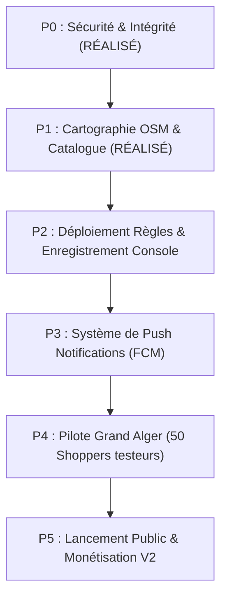

# 9DILI EXPRESS — ROADMAP PRODUIT & TÂCHES RESTANTES

**Application :** 9DILI EXPRESS  
**Date d'élaboration :** 16 Octobre 2026  
**Horizon :** Version 1.0 (Lancement Opérationnel Pilote Algérie)

---

## 1. Priorités et Étapes Restantes



---

## 2. Tableau des Tâches Restantes par Priorité

| Priorité | Domaine | Tâche à Accomplir | Prérequis / Dépendance | Risque |
| :---: | :--- | :--- | :--- | :---: |
| **P2** | **Firebase** | Déployer `firestore.rules` et `storage.rules` sur le projet `dili-express`. | Firebase CLI authentifié | Faible |
| **P2** | **Console** | Enregistrer l'empreinte SHA-1 dans la console Firebase pour activer Google Sign-In sur `com.ghdinteractivestudio.dili_express`. | Accès Console Firebase | Faible |
| **P2** | **App Check**| Enregistrer le Debug Token App Check pour les tests sur simulateur / appareils locaux. | Accès Console Firebase | Faible |
| **P3** | **Notifications**| Implémenter Firebase Cloud Messaging (FCM) pour alerter les Shoppers des nouvelles missions en arrière-plan. | Certificat FCM | Moyen |
| **P3** | **UI/UX** | Intégrer l'écran visuel de sélection directe depuis le catalogue dans le tunnel de création de courses. | Composants existants | Faible |
| **P4** | **Paiement** | Intégration passerelle CIB / Edahabia (SATIM) pour le rechargement du porte-monnaie Shopper et Client. | Agrément bancaire GIE Monétique | Moyen |
| **P4** | **Terrain** | Phase de test bêta fermée sur les communes d'Alger Centre, Bab Ezzouar et Hydra avec 50 livreurs. | Version APK Release signée | Moyen |

---

## 3. Matrice des Risques Opérationnels & Atténuation

| Risque Identifié | Impact | Probabilité | Stratégie d'Atténuation Validée |
| :--- | :---: | :---: | :--- |
| **Plafond de quota Google Maps** | Critique | 0% | **Éliminé à 100% :** Transition complète vers OpenStreetMap sans frais d'API. |
| **Falsification de solde ou de rôle** | Élevé | Faible | **Éliminé à 100% :** Règles Firestore verrouillées côté serveur contre l'usurpation de champs. |
| **Fraude à la livraison sans remise réelle** | Élevé | Faible | **Éliminé à 100% :** Isolation du PIN dans `/secrets/pin` inaccessible aux livreurs avant remise en main propre. |
| **Réseau 3G/4G instable en magasin** | Modéré | Élevée | Mode hybride hors-ligne du catalogue local + mise en cache des articles et tickets. |
| **Dépassement de capacité physique** | Modéré | Modérée | Contrôle bloquant `canCarry()` interdisant les paniers volumineux aux piétons et vélos. |

---

## 4. Prérequis pour le Lancement Public (Checklist Administrateur)

- [ ] Exécuter la commande de déploiement des règles :
  ```bash
  firebase deploy --only firestore:rules,storage:rules --project dili-express
  ```
- [ ] Dans Google Cloud / Firebase Console :
  Ajouter le SHA-1 `7D:F2:A7:43:F4:3A:60:3A:C1:E1:DD:B8:26:81:FE:C5:09:59:FA:20` à l'application `com.ghdinteractivestudio.dili_express`.
- [ ] Activer Play Integrity Provider dans l'onglet App Check avant la mise en ligne sur le Google Play Store.
